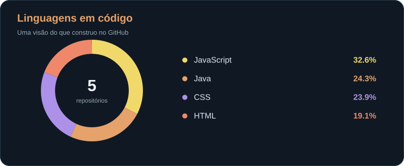

<!-- HEADER -->

 

---

## ☕ Sobre mim

Sempre gostei de entender como as coisas funcionam e de transformar ideias em algo que realmente possa ser usado.

Foi justamente essa curiosidade que me levou para a programação e continua sendo uma das coisas que mais gosto na área: **aprender, experimentar e encontrar maneiras melhores de resolver problemas**.

Meu foco está no desenvolvimento **Full Stack**, com um interesse especial pelo que acontece por trás das aplicações: a lógica, a organização do código e a forma como os dados são armazenados e utilizados.

Gosto de conectar essas partes a interfaces funcionais — e de entender cada decisão ao longo do caminho.

📍 Rio de Janeiro, Brasil

---

## 🚀 Tecnologias

### Back-end & Dados

 

### Front-end

 

### Ferramentas

  

Proporção de código nos meus repositórios públicos, por bytes detectados pelo GitHub. Não inclui forks nem este repositório de perfil.

---

## 🤝 Onde me encontrar

 

